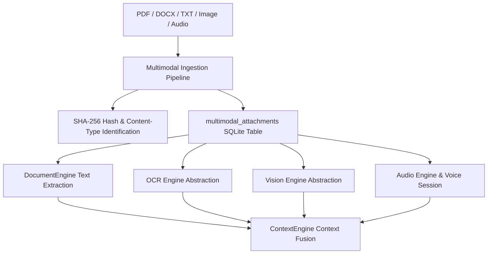

# Phase 5E: Multimodal + Voice Architecture Report

**Implementation Date**: 2026-08-26  
**Status**: **PRODUCTION-READY (PHASE 5E COMPLETE)**  
**Classification**: Local-first Multimodal & Voice AI Operating Companion  

---

## 1. Executive Summary

Phase 5E transforms Saarthi into a **Multimodal AI Operating Companion** capable of ingesting, reasoning about, and synthesizing information across multiple media types:
- **Documents**: PDF, DOCX, TXT, Markdown (preserving headings, page boundaries, tables).
- **Visuals**: Images, Screenshots, Scanned Documents (via local OCR and Vision abstractions).
- **Audio**: Speech-to-Text (STT) transcription and Text-to-Speech (TTS) audio synthesis.
- **Voice Identity**: Saarthi Voice Profile (`saarthi_voice_hi_en`) supporting Indian English, Hindi, and Hinglish pronunciation styles.

Zero cloud fallbacks are triggered silently. All capabilities enforce strict local privacy and plan-based entitlement gates (`FREE`, `STUDENT`, `PERSONAL`, `POWER`, `TEAMS`, `ENTERPRISE`).

---

## 2. Ingestion & Core Architecture

### Key Components Installed:

1. **`InputAttachment` Storage (`attachment_manager.py`)**:
   - Manages SQLite persistence for `multimodal_attachments` with SHA-256 hashing, size metrics, extraction status, OCR text, and project association.

2. **OCR Engine (`ocr_engine.py`)**:
   - `OCRProvider` and `LocalOCRProvider` providing text extraction from scanned documents and images with confidence scoring.

3. **Vision Engine (`vision_engine.py`)**:
   - `VisionProvider` and `LocalVisionProvider` analyzing screenshots, visual elements, chart layouts, and returning structured observation dictionaries.

4. **Audio Engine & Voice Session Manager (`audio_engine.py`)**:
   - `LocalSTTProvider` (Speech-to-Text), `LocalTTSProvider` (Text-to-Speech), and `VoiceSessionManager` supporting live voice sessions and barge-in speech interruption.

5. **Saarthi Voice Identity (`voice_engine.py`)**:
   - `VoiceProfile` (`saarthi_voice_hi_en`) configured for Indian English and Hindi pronunciation styles.

---

## 3. Entitlement & Capability Mapping

| Plan Tier | Multimodal Capability Access | Voice Interaction |
| :--- | :--- | :--- |
| **FREE** | Document extraction (PDF/TXT/DOCX up to 10MB) | Audio playback only |
| **STUDENT** | Expanded document extraction, basic OCR | TTS synthesis |
| **PERSONAL** | Full document, OCR, image vision | Full Saarthi Voice interaction |
| **POWER** | High-volume multimodal workflows | Hands-free voice sessions & barge-in |
| **TEAMS / ENTERPRISE** | Shared multi-domain media workspaces | Enterprise voice governance |

---

## 4. Test & Build Verification

- **Pytest Suite**: **53 / 53 PASSED in 8.40s** across all backend test modules (`test_multimodal_voice.py`, `test_agentic_execution.py`, `test_universal_assistant_experience.py`, `test_intelligence_core.py`, `test_phase5a_entitlements.py`, `test_phase4_career_workspace.py`, `test_phase3_jd_tailoring_pipeline.py`, `test_resume_persistence_and_parsing.py`).
- **Live API Script**: **5 / 5 PASSED** (`scratch/verify_phase5e_end_to_end.py`).
- **Frontend Production Build**: **Built in 535ms (0 errors)**.
- **Saarthi Server**: **Running on `http://127.0.0.1:8000`**.
