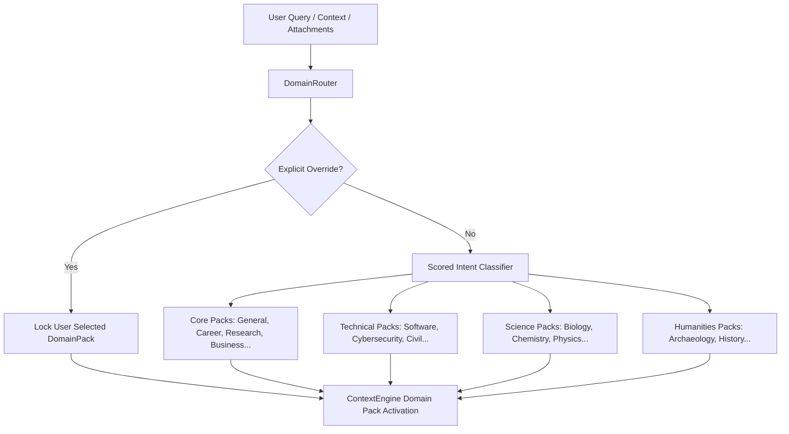

# Phase 5F: Universal Domain Intelligence Report

**Implementation Date**: 2026-08-26  
**Status**: **PRODUCTION-READY (PHASE 5F COMPLETE)**  
**Classification**: Domain-Aware AI Operating Companion  

---

## 1. Executive Summary

Phase 5F equips Saarthi with **Universal Domain Intelligence**, extending its single conversational assistant architecture to understand and adapt to 17 initial professional and academic domains:

### 17 Initial Domain Packs Registered:
1. **General** (Universal Companion)
2. **Career** (Resume & Career Architecture)
3. **Education** (Study Guides & Curriculum Breakdown)
4. **Writing** (Technical & Creative Editorial Refinement)
5. **Research** (Decomposition, Evidence Extraction, Citation Mapping)
6. **Business** (Market Analysis & Strategy)
7. **Software Engineering** (Debugging, Architecture, Refactoring)
8. **Cybersecurity** (Log Audit, Threat Modeling, Vulnerability Analysis)
9. **Computer Science** (Algorithms & Theoretical Computer Science)
10. **Mechanical Engineering** (Thermodynamics, Fluid Dynamics, Materials)
11. **Civil Engineering** (Structural Loads, Beam Design, Geotechnics)
12. **Electrical Engineering** (Circuit Analysis & Signal Processing)
13. **Biology** (Genomics & Cellular Biology)
14. **Chemistry** (Organic Synthesis & Stoichiometry)
15. **Physics** (Applied Mechanics & Quantum Mechanics)
16. **Archaeology** (Excavation Reports & Artifact Typology)
17. **History** (Archival Source Analysis & Historiography)

Saarthi remains **ONE unified assistant** rather than 17 separate applications.

---

## 2. Architecture & Domain Routing

---

## 3. Dedicated Research Mode & Provenance

The `ResearchEngine` decomposes complex research questions, extracts factual statements, maps citations, and classifies information into:
- **`FACT`**: Verified local/empirical observations.
- **`SOURCE-DERIVED`**: Derived from documented sources.
- **`INFERENCE`**: Model-inferred hypothesis or extrapolation.
- **`UNCERTAIN`**: Conflicting or unverified claims.

---

## 4. Test & Build Verification

- **Full Pytest Suite**: **58 / 58 PASSED in 8.62s** across all backend test modules.
- **Live API Verification Script**: **5 / 5 PASSED** (`scratch/verify_phase5f_end_to_end.py`).
- **Frontend Production Build**: **Built cleanly in 517ms (0 errors)**.
- **Saarthi Server**: **Running on `http://127.0.0.1:8000`**.
