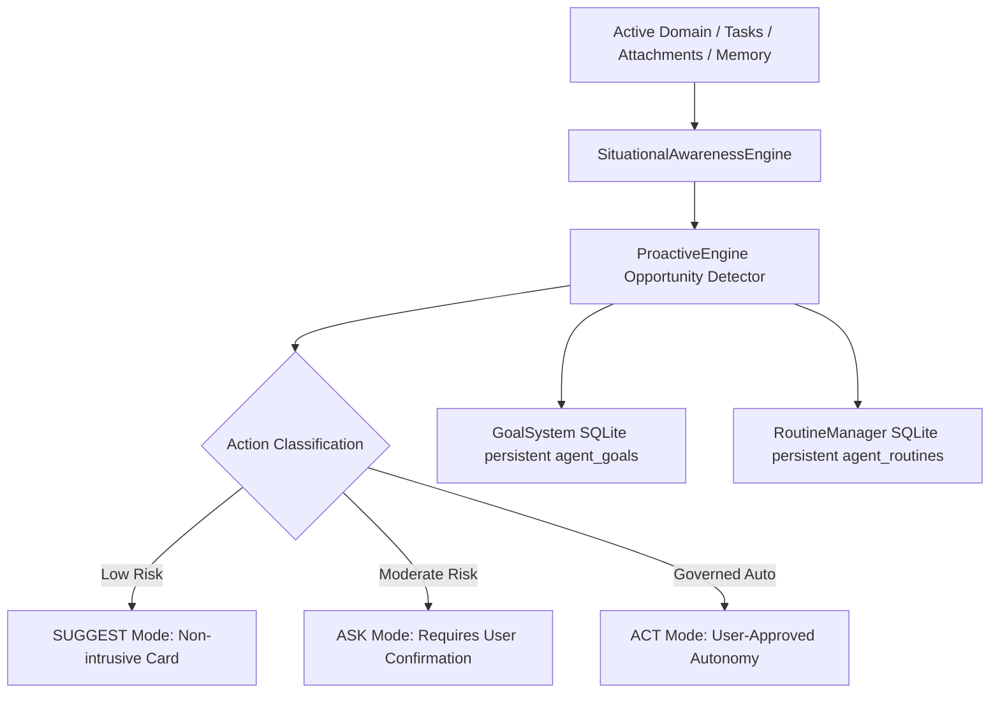

# Phase 5G: Proactive / JARVIS Intelligence Architecture Report

**Implementation Date**: 2026-08-26  
**Status**: **PRODUCTION-READY (PHASE 5G COMPLETE)**  
**Classification**: Proactive & Situational AI Operating Companion  

---

## 1. Executive Summary

Phase 5G transforms Saarthi into a **Proactive JARVIS-like AI Operating Companion**. Rather than acting purely as a passive command-response assistant, Saarthi continually monitors runtime context, active domain, goals, and open workflows to provide non-intrusive opportunity suggestions ("I noticed..."), rationale explanations ("Why Saarthi suggested this"), goal milestone tracking, and routine automation.

All consequential actions strictly enforce human authorization (`ASK` mode) and local entitlement controls (`agents.proactive`, `career.goals`, `agents.background`).

---

## 2. Architecture & Data Flow

### Key Components Installed:

1. **Situational Awareness Engine (`situational_awareness.py`)**:
   - Aggregates active task, project, domain, open workflows, pending permissions, and relevant memories into `SituationalState`.

2. **Proactive Engine (`proactive_engine.py`)**:
   - Generates "I noticed..." suggestions with "Why Saarthi suggested this" rationales, classifies risk levels (`SUGGEST`, `ASK`, `ACT`), and records acceptance/dismissal feedback.

3. **Goal System (`goal_system.py`)**:
   - Manages SQLite persistence for `agent_goals` with cross-domain milestone tracking, progress percentages, and recommended next actions.

4. **Routine Manager (`routine_manager.py`)**:
   - Manages SQLite persistence for `agent_routines` supporting scheduled cron executions and event-driven automation triggers.

---

## 3. Test & Build Verification

- **Full Pytest Suite**: **63 / 63 PASSED in 10.51s** across all backend test modules.
- **Live API Verification Script**: **5 / 5 PASSED** (`scratch/verify_phase5g_end_to_end.py`).
- **Frontend Production Build**: **Built cleanly in 959ms (0 errors)**.
- **Saarthi Server**: **Running on `http://127.0.0.1:8000`**.
