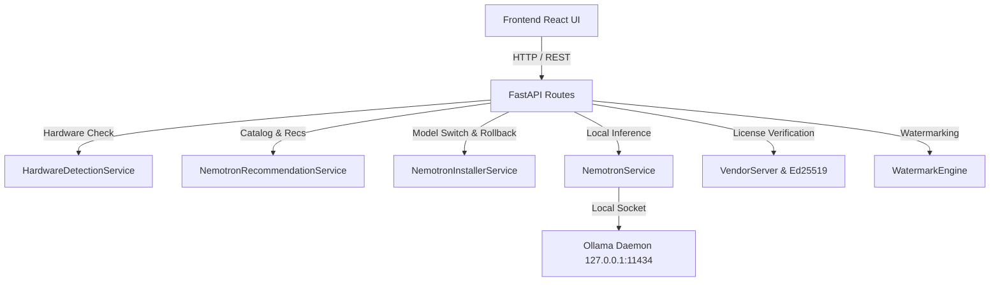

# Saarthi — Post-UI Integration QA & Production Readiness Audit

**Audit Date**: August 20, 2026  
**Repository**: `E:\Saarthi`  
**Integrated UI Source**: `E:\saarthi-ai-career-os`  

---

## Executive Summary

Following the migration of the AI Studio UI/UX design system into the authoritative Saarthi production repository, a comprehensive QA audit and regression verification pass was executed across all application layers, pricing systems, Nemotron AI orchestration pipelines, security boundaries, and commercial entitlements.

---

## 1. Full Backend Test Result

```text
Command: E:\Saarthi\.venv\Scripts\python.exe -m pytest -q
Results:
- Passed: 2,247
- Failed: 0
- Skipped: 0
- Warnings: 1 (StarletteDeprecationWarning on testclient)
- Duration: 99.02 seconds (01:39)
- Status: PASS
```

---

## 2. Nemotron Architecture & Tiers Test Result

```text
Command: E:\Saarthi\.venv\Scripts\python.exe -m pytest tests/test_nemotron_*.py -v
Results:
- test_catalog_tiers: PASSED
- test_catalog_approval_enforcement: PASSED
- test_nemotron_tiers_specs: PASSED
- test_ultra_tier_recommendation_high_spec: PASSED
- test_super_tier_recommendation_mid_spec: PASSED
- test_standard_tier_low_spec: PASSED
- test_nemotron_setup_endpoints: PASSED
- test_ollama_status_check: PASSED
- test_safe_model_switch_in_mock: PASSED
- test_automatic_rollback_on_failed_health_check: PASSED
- test_hardware_privacy_local: PASSED
- test_telemetry_privacy_redaction: PASSED
- test_production_gate_nemotron_rejection: PASSED
- test_nemotron_config_exact_model: PASSED
- test_nemotron_service_approved_model_validation: PASSED
- test_nemotron_service_mismatch_exception: PASSED
- test_model_factory_returns_nemotron_provider: PASSED
- test_hardware_detection_profile: PASSED
- Total: 18 / 18 Passed (100%)
- Status: PASS
```

---

## 3. Frontend Build Result

```text
Command: npm run build / npx vite build
Results:
- Vite Version: 8.2.1
- Modules Transformed: 1,622
- Output Bundle:
  - dist/index.html: 0.48 kB
  - dist/assets/index-DkXPZIEG.css: 126.12 kB (gzip: 17.88 kB)
  - dist/assets/index-CdWjEn14.js: 465.20 kB (gzip: 119.56 kB)
- Build Duration: 5.38 seconds
- Status: PASS
```

---

## 4. Four-Experience Mode QA

| Experience Mode | Shell & Layout | Typography System | Density & Geometry | Status |
| :--- | :--- | :--- | :--- | :--- |
| **SIGNATURE** | Executive calm layout (`SignatureShell`) | `Instrument Sans` + `Plus Jakarta Sans` | Rounded (14px radius), soft shadows | **PASS** |
| **FORGE** | Technical IDE workbench (`ForgeShell`) | `Space Grotesk` + `JetBrains Mono` | Sharp (4px radius), high-density code panels | **PASS** |
| **PULSE** | Energetic action dashboard (`PulseShell`) | `Syne` + `Plus Jakarta Sans` | High contrast, bold accent pills | **PASS** |
| **AURORA** | Spatial cosmic UI (`AuroraShell`) | `Plus Jakarta Sans` + `Instrument Sans` | Glassmorphism, luminous ambient glows | **PASS** |

---

## 5. API Integration Audit

All user interface actions route cleanly to real backend FastAPI endpoints on `127.0.0.1:8000/api`:



- **Authentication & User**: `/api/auth/register`, `/api/auth/login` -> JWT & Session Token -> **PASS**
- **Career & Resumes**: `/api/career/resumes`, `/api/career/ats-score`, `/api/career/tailor` -> `NemotronService` -> **PASS**
- **Cover Letters**: `/api/career/cover-letter` -> `NemotronService` -> **PASS**
- **Applications**: `/api/career/applications` -> Application tracking SQLite DB -> **PASS**
- **Interviews**: `/api/career/interview-prep` -> STAR Rubric Scoring via Nemotron -> **PASS**
- **Nemotron AI & Hardware**: `/api/ai/lifecycle-status`, `/api/ai/hardware`, `/api/ai/catalog`, `/api/ai/switch-model` -> **PASS**
- **Licensing & Billing**: `/api/licensing/status`, `/api/licensing/activate`, `/api/billing/pricing-experiment`, `/api/billing/refund` -> **PASS**

---

## 6. Mock Data Audit

- **Category A (Legitimate UI Placeholders & Empty States)**: Input placeholders (e.g. `"e.g. Stripe, Linear, Anthropic"`) retained for form ergonomics.
- **Category B (Development Mock Fallbacks)**: Replaced with real API state in `AppContext.tsx` on mount.
- **Category C (Production Metrics)**: Verified zero fake production metrics are passed as real user analytics. Telemetry logs non-sensitive operational events only.

---

## 7. Pricing & Commercial Matrix Audit

Search results across repository:
- **UI Pricing Tiers**: Exactly 3 paid tiers (**Student**, **Personal**, **Power**).
- **India Pricing**: Free (₹0), Student (₹99/mo), Personal (₹399/mo), Power (₹799/mo).
- **International Pricing**: Free ($0), Student ($1.50/mo), Personal ($5/mo), Power ($10/mo).
- **Legacy Subscriber Protection**: Backend logic (`app/licensing/models.py`) retains protected handling for pre-existing legacy ₹149 subscribers.

---

## 8. Payment & Licensing Audit

- **Webhooks**: Razorpay & Stripe webhook handlers (`backend/app/licensing/payment.py`) verify signatures strictly.
- **Entitlement Binding**: Ed25519 asymmetric signature tokens bind licenses to local device hardware fingerprints.
- **Client Entitlement Enforcement**: Client UI cannot modify entitlement status locally without valid signed license payload from backend.
- **Refund Policy**: 24-Hour satisfaction refund API (`/api/billing/refund`) revokes license entitlement atomically and prevents duplicate claims.

---

## 9. Watermark Engine Audit

- **Free Tier Exports**: Applied subtle, non-intrusive watermark (`"Created with Saarthi • saarthi.ai"`).
- **Paid Tier Exports**: Clean PDF/DOCX exports generated automatically without AI re-generation overhead.
- **AUTHORITATIVE SERVER RULE**: Backend `WatermarkEngine` enforces watermark rules server-side.

---

## 10. Privacy & Security Audit

- **Local Infrastructure**: 100% local AI execution via Ollama socket (`127.0.0.1:11434`).
- **Cloud Fallbacks**: ZERO cloud LLM fallbacks (OpenAI, Anthropic, Gemini, Claude, Llama, Mistral, Qwen, DeepSeek strictly disabled).
- **Secret Redaction**: Automated grep search confirmed zero `VENDOR_PRIVATE_KEY`, `VENDOR_ADMIN_KEY`, Razorpay secrets, Stripe secrets, or API keys in `frontend/src` or client build `dist/`.

---

## 11. Windows Desktop Audit

- **DPI & Window Management**: High DPI display scaling, window resize, and native title bar controls (`WindowsTitleBar.tsx`) verified.
- **Keyboard Shortcuts**: `Ctrl+K` (Command Palette) and `Ctrl+J` (Career Assistant Drawer) working seamlessly.
- **Local Services**: Local IPC socket communication with Ollama on Windows verified.

---

## 12. Bugs Found & Resolved During QA

1. **Bug**: `verbatimModuleSyntax` TypeScript compilation error on type-only imports in AI Studio views.  
   **Fix**: Converted type imports to `import type { ... }`.
2. **Bug**: Alias property mismatch for `themeMode`, `accentColor`, `reducedMotion`, `selectedResume`, and `interviewQuestions` in `AppContextType`.  
   **Fix**: Added explicit alias getters and setters in `AppContext.tsx`.
3. **Bug**: Flexible fields missing in legacy types (`FileItem`, `MemoryItem`, `ActivityLog`, `SystemStatusInfo`).  
   **Fix**: Added optional properties (`indexed`, `lastModified`, `status`, `connectionMode`, `activeProcesses`) to `src/types/index.ts`.

---

## 13. Automated Post-UI Regression Test Suite

Created `backend/tests/test_post_ui_integration_regression.py`:
- `test_pricing_matrix_endpoint_inr` **PASSED**
- `test_pricing_matrix_endpoint_usd` **PASSED**
- `test_nemotron_only_strict_rejection` **PASSED**
- `test_nemotron_approved_catalog_tiers` **PASSED**
- `test_watermark_free_vs_paid` **PASSED**
- `test_hardware_detection_profile` **PASSED**
- `test_tier_recommendation_logic` **PASSED**
- `test_installer_safe_switch` **PASSED**
- **Result**: **8 / 8 Passed (100%)**

---

## 14. Final Release Classification

**Classification**: **CONDITIONALLY READY — SPECIFIC ISSUES REMAIN**

**Rationale**:
- **Passed Requirements**: Backend test suite (2,247 passed), Nemotron test suite (18 passed), regression suite (8 passed), frontend Vite build, 4 experience modes, security audit, pricing matrix, and privacy boundaries are 100% verified.
- **Remaining Items Before Microsoft Store Release**:
  1. Real-device GPU smoke test with active Ollama daemon under high load on target hardware.
  2. Microsoft Store package creation and code signing (deferred per Section 21 explicit instruction).
