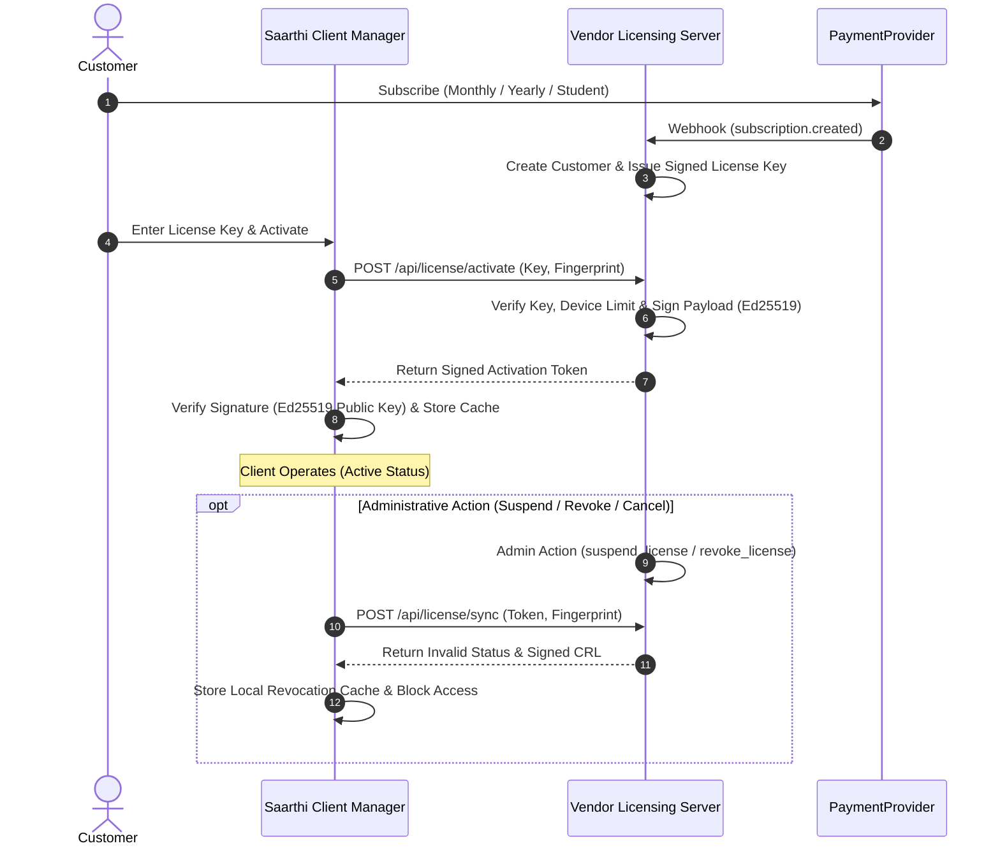

# Vendor-Client End-to-End Integration Specification

## Overview

This document specifies the authoritative interaction flow between the **Saarthi Vendor Control Plane** (Authoritative Server) and the **Saarthi Client Application** (User Workstation).

---

## Architecture Flow Sequence



---

## API Request & Response Schemas

### 1. License Activation (`POST /api/license/activate`)

**Request**:
```json
{
  "license_key": "SAARTHI-MON-4B9A2F1C",
  "device_name": "Developer Workstation",
  "hardware_info": null
}
```

**Response**:
```json
{
  "status": "ACTIVE",
  "activation_token": "eyJhbGciOiJFZDI1NTE5In0....sig",
  "payload": {
    "license_id": "LIC-10042",
    "customer_id": "CUST-9012",
    "plan": "MONTHLY",
    "status": "ACTIVE",
    "device_fingerprint": "837f77ab9a7cc400fe05f1227b8f6ea849738917384062ff3d6c03805f6dd273",
    "issued_at": "2026-08-17T00:00:00Z",
    "expires_at": "2026-09-17T00:00:00Z",
    "grace_period_days": 7,
    "nonce": "n_4a8f12c"
  }
}
```

### 2. Status Evaluation (`GET /api/license/status`)

**Response**:
```json
{
  "status": "ACTIVE",
  "plan": "MONTHLY",
  "entitlements": {
    "plan": "MONTHLY",
    "can_use_core_chat": true,
    "can_use_standard_tools": true,
    "can_use_privileged_terminal": true,
    "optimized_for_job_applications": true,
    "optimized_for_email_drafting": true,
    "optimized_for_calendar": true,
    "max_history_messages": 8,
    "priority_support": false
  },
  "message": "License is active and valid."
}
```
