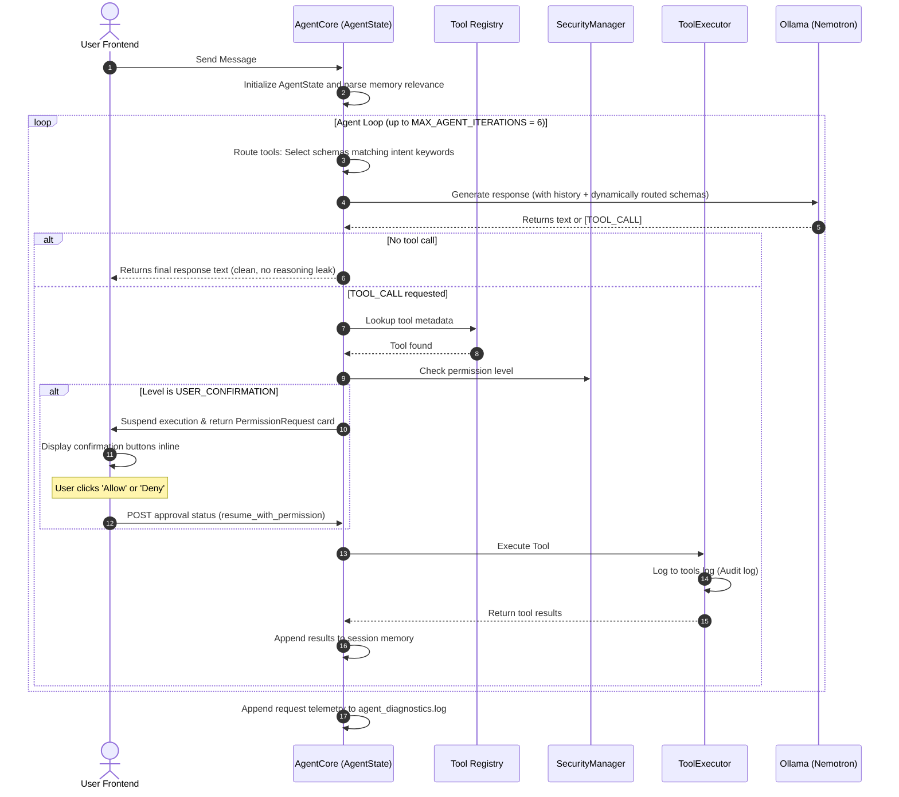

# Saarthi v0.5 Architecture Documentation

Saarthi is structured with a modular, provider-independent architecture designed to support a desktop agent's development over time.

---

## Core Abstractions

### 1. Model Layer (`ModelProvider`)
- Provides an abstract base class (`ModelProvider`) defined in [base.py](file:///E:/Saarthi/backend/app/models/base.py).
- Resolves provider selections dynamically via [factory.py](file:///E:/Saarthi/backend/app/models/factory.py) based on environmental configuration.
- Integrates `NemotronProvider` which uses Ollama to interact with the local `nemotron-3-nano:4b` model.

### 2. Upgraded Memory Layer (`MemoryProvider` & `MemoryManager`)
- Core abstraction in [base.py](file:///E:/Saarthi/backend/app/memory/base.py) with database implementation inside [sqlite.py](file:///E:/Saarthi/backend/app/memory/sqlite.py).
- Records user-assistant message threads in an SQLite relational database under `E:\Saarthi\data\database\saarthi.db`.
- Relevance search: Computes relevance using exact keyword matches, query word extraction, category preferences (USER, PREFERENCE, FACT, INSTRUCTION, WORKFLOW, OTHER, PROJECT, TASK, SYSTEM), and metadata confidence scaling (metadata `confidence` default 1.0).
- Credentials Filter: Prevents sensitive data (tokens, passwords, keys) from being saved in database memory.

### 3. Tool System (`BaseTool` & `ToolRegistry`)
- Defines standard structures for agent capabilities: name, description, permission requirements, risk classification, and schemas.
- All tools must inherit from [base.py](file:///E:/Saarthi/backend/app/tools/base.py) and register inside [registry.py](file:///E:/Saarthi/backend/app/tools/registry.py).

### 4. Smart Tool Selection (Routing)
- Reduces prompt sizes by dynamically routing tool schemas based on the latest prompt context keywords:
  - File keywords → `file_list`, `file_search`, `file_read`
  - System keywords → `system_info`
  - Command keywords → `terminal`
  - Memory keywords → `suggest_memory`
  - Unknown / General query → No tools provided (forces direct text completion)
  - Tool calls already active in the current request flow loop are automatically preserved.

### 5. Security & Permissions (`SecurityManager`)
- Operating permission structure inside [permissions.py](file:///E:/Saarthi/backend/app/security/permissions.py).
- Manages permission levels (`READ_ONLY`, `SAFE`, `USER_CONFIRMATION`, `PRIVILEGED`) and exposes a structured store (`PermissionStore`) for handling user decisions.
- Enforces strict canonical path matching (`is_path_allowed`) to prevent directory traversal and unauthorized directory escapes.

### 6. Audit & Diagnostics Logging
- **Audit Logs**: All tool executions are recorded to `E:\Saarthi\data\logs\tools.log` including timing, parameters, and statuses.
- **Diagnostics Logs**: Appends structured JSON lines to `E:\Saarthi\data\logs\agent_diagnostics.log` containing request ID, session ID, prompt token estimates, tool names, execution and model latencies, iteration counts, and error status.
- Sanitizes and removes passwords/tokens before writing logs.
